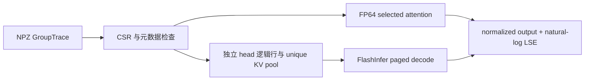
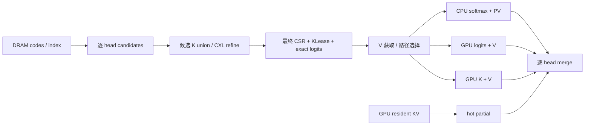

# 数据与执行契约

## 1. 范围与不变量

一个请求、一个 decode step、一个 layer、一个 KV group，r 个 Q heads 共用 K/V。v1 支持已完成位置变换的 Q/K、标准 scaled inner product、相同 Q/K/V head dimension。额外 bias、soft-cap、attention sink logits 等需要新的显式契约。

对每个 head h，最终选集为 S_h；U = union(S_h) 只决定可合并的物理数据，M[h,i] 决定 attention 语义。将全部 heads 的逻辑选集改成 U 不属于本实验的等价执行。

- 分区两两不交且并集为 S_h，mandatory tokens 已去重。
- Q/K/V、位置、模型精度和 epoch 一致。
- 原精度 logits 只能来自同一个 step/head 的真实分数。
- 固定选集允许浮点归约差异，不等于 sparse 与 full attention 等价。

## 2. 当前源码链路



当前没有 NUMA allocator、CXL backend 或计时循环。NPZ load 和 NumPy advanced indexing 会分配普通 host memory；GPU adapter 还会创建 selected KV 副本与 workspace。它是数值接口起点，不可用于论文性能结论。

## 3. Trace v1

文件由 `numpy.savez` 写入，不使用 pickle。输入仅接受可信的本地研究文件。

| 字段 | 形状 / 类型 | 语义 |
|---|---|---|
| q | [r,d] float32/float64 | 当前 step 的真实位置变换后 Q |
| k / v | [N,d] float32/float64 | 一个共享 KV head 的 canonical 内容 |
| indptr | [r+1] integer | head 的 CSR 边界 |
| indices | [sum_h |S_h|] integer | canonical K/V 的 row ID，非 position 或 packet offset |
| positions | [N] integer | 各 row 对应的原始 token position |
| metadata_json | scalar Unicode JSON | 下列元数据 |

必需元数据：`format_version=1`、`origin`、`model_id`、`model_revision`、`request_id`、`step`、`layer`、`kv_group`、`epoch`、`query_position`、`sm_scale`、`score_semantics=scaled_dot_product_post_rope`、`position_transform`、`source_dtype`。

真实模型额外记录 `capture_mode`、`prompt_id`、`q_head_ids`、`model_config_sha256`。`position_transform` 推荐为包含 RoPE 配置的 JSON object；代码只能验证存在，模型 capture 负责正确性。

BF16/FP16 tensor 可以无损转换成 float32 存入 NPZ。NPZ 的磁盘/host 占用因此不同于 canonical BF16 payload，两者不得混算。GPU adapter 检查目标 dtype 的往返转换是否保留数值，拒绝静默降低精度。

`GroupTrace` 的 frozen dataclass 只禁止重绑字段，不保证内部数组/字典物理只读。调用者负责把已记录 trace 当不可变证据。当前不是并发 runtime 的生命周期实现。

## 4. Partial state

对于一个 head 的分区 P，s_i = scale · qᵀk_i：

```text
m = max(s_i)
z = sum exp(s_i - m)
o = sum exp(s_i - m) V_i / z
L = m + ln(z)
```

标准输出为 `(o, L)`，L 使用自然对数。空分区输出零向量和 `L=-inf`。

归并 A/B 时：`L=logaddexp(L_A,L_B)`，`o=exp(L_A-L)o_A+exp(L_B-L)o_B`；两个分区都空时单独返回空状态，避免 `-inf - -inf`。代码不持有 partition provenance，调用者必须保证不重不漏。

所查 FlashInfer 常规 attention/cascade 路径采用 base-2 LSE。当前 adapter 将它乘 `ln(2)` 转为内部格式；调用 FlashInfer merge 时应反向除以 `ln(2)`。更换 backend 时重新核实数值约定。

## 5. GPU 初始映射

- 每个非空 Q head 作为一个逻辑 request，`num_qo_heads=num_kv_heads=1`。
- Q 为 `[active_heads,1,d]`；K/V pool 为 `[unique_tokens,1,1,d]`。
- CSR indices 可以跨 heads 指向同一个 pool entry，保留存储去重。
- `page_size=1` 是 GPU adapter 视图；未来 CXL backing page 可以独立设为 16/32/64 tokens。
- Q/K 已做位置变换，kernel 使用 `pos_encoding_mode=NONE`。
- 独立行可能丢失 kernel 内 GQA 复用；后续以 membership/signature 分组测量该代价。
- 空 heads 不提交给 wrapper，结果保留零输出和 `-inf`。

## 6. 目标数据通路：下一阶段



候选契约与最终选择契约分开：

```text
Candidates { request, step, layer, group, epoch, head_indptr, token_ids,
             approximate_scores, optional_exact_logits }
KLease     { owner, epoch, token_to_offset, source_precision, ready_event,
             remaining_consumers }
Selection  { identity, final_head_indptr, final_ids, mandatory_policy,
             selected_K_lease, exact_logit_ref }
Work       { route, physical_spans, head_membership, buffer_slot, completion }
```

exact-logit identity 还包含 step、head、score semantics；K identity 不包含 step，但包含 request/layer/group/epoch/token。不能把不同 step 的 logits 放入仅由 token ID 索引的缓存。

对每 head 只在 C_h 内精排，union 只合并 K 读取。选中 K 的 lease 交给执行端；不选中候选及时释放。V 到最终选集确定后才获取。默认 GPU resident token 留在 hot 路径，除非明确计入跨设备取回的成本。

KLease、staging、packet、partial buffers 必须有独立且有界的预算，完成事件覆盖所有消费者，包括异步 cache install。MVP 采用只读 base + exact delta；backing 和 index 可见性同时就绪后再发布 epoch。
