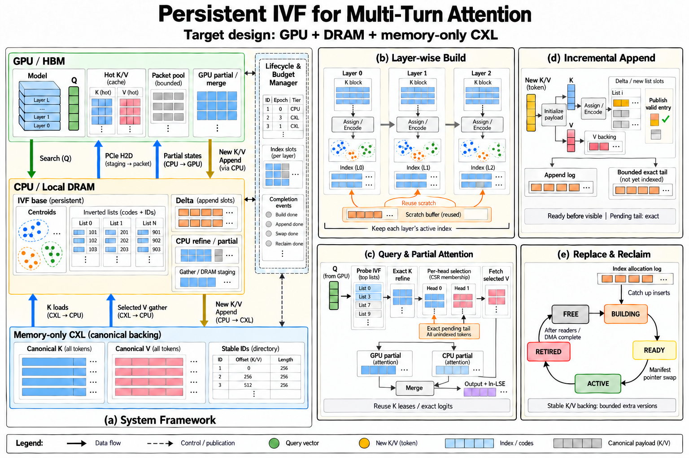

# 面向多轮超长上下文的持续 IVF 检索与分层 partial attention 系统

研究提案，更新：2026-10-13。目标平台为单节点 PCIe A100、CPU DRAM 和 memory-only CXL；本提案中的机制与预期贡献尚待实验验证。本文件结合当前源码、既有实验和 owner 明确的多轮时序。2026-09-30 稿曾按 owner 要求同步至 [wiki research 提案](../../kvcache-wiki/raw/research/CXL_KV_Research_Proposal_2026-09-28.md)；本次仅修改本仓库，wiki raw 保持原状。版本与证据边界见 [PROVENANCE.md](PROVENANCE.md)。

## 1. 背景与动机

### 1.1 从固定上下文检索走向持续多轮 KV

长上下文推理需要保留随输入与生成增长的 K/V。训练后 sparse decode 通过向量检索选择部分历史 token，能减少一次 attention 的读取与计算，但完整 KV、索引、缓存与临时缓冲仍占容量。多轮对话使问题更加具体：每个 turn 引入一批 prefill K/V，assistant decode 逐 token 追加，后续查询继续访问早期历史；topic、访问热点和 list 分布会随 session 改变。

因此，研究对象是整个 session 的索引与 attention 生命周期。只在固定 prompt 上建一次索引，随后仅报告 decode 延迟，会隐藏新轮追加、索引维护、峰值分配和老版本回收的代价。应同时解释：插入是否足够便宜、索引何时仍值得复用、何时更换，以及维护是否挤占真正需要的查询带宽。

具体起点是已有约 100K 历史与可查询 IVF 的多轮 session。本轮 decode 继续积累 delta，
定期沿用现有参数插入活动索引；**full rebuild 只在下一轮 prefill 开始时决定并启动**。
下一轮既有历史 K 可立即供索引 builder 使用，新 suffix 的 prefill 再逐层提供新增 K。
prefill 窗口提供调度机会，但不是免费隐藏维护的保证：赶不上的构建、追赶和发布计入新轮
TTFT。GPU 保留有限 prefix/热点 KV，GPU partial 与 CPU 历史 partial 合并为最终 attention。

### 1.2 为什么选择 IVF 与替换式维护

IVF 将 coarse routing、list 扫描和候选精排分开，方便控制新条目的 assignment/encoding 与 list append，也方便把 codes、ID 和原 K 分层放置。它并不保证优于图索引：attention 的 Q/K 分布差异、偏斜、较高 nprobe、分散 K gather 和小批开销都可能使其变慢。当前主线先选择 IVF，以隔离持续更新和内存生命周期；图索引暂不作为核心开发。

一个可探索的机制是：下一轮 prefill 开始时在另一个已预留槽位建立新版本，追赶该次 prefill 写入后切换 manifest 指针，等旧查询结束再回收。索引槽位以环形方式复用，减少反复分配和大范围 reset。轮内 delta flush 只追加条目，不换 centroid/codebook；prefill 的逐 layer 调度为逐层建索引和 scratch 复用提供机会。

这些机制有先例：HAKES 涉及 CPU 并发插入与 filter-refine，SIVF 涉及 GPU streaming append 的发布安全，InSituANN 提供 snapshot/delta 与替换式维护参照，Quake 研究自适应维护。[R1–R4] 本研究要验证它们在多轮、小批 Q、逐 token 更新和 attention 质量约束下的适配，而不是把指针切换本身包装成贡献。

### 1.3 为什么执行与内存管理必须一起研究

索引找到 token 后，仍需读取原 K 精排、获取 V、执行 softmax/PV 并归并 partial。检索阶段已经获得的 K 或 exact logits，若在执行阶段丢弃，会产生重复访问；GQA heads 的选集重叠又可能提供共享物理读机会。与此同时，索引双缓冲、candidate K、HBM cache、pinned packet 和 GPU workspace 必须争用同一资源预算。

我们以三个相互约束的目标开展研究：

| 目标 | 操作化定义 |
|---|---|
| 有效性 | 在预先登记的质量要求下，检索召回、attention 误差和多轮任务质量足够好；正确保留 KV、position 和逐 head mask |
| 高效率 | 降低整个 session 的构建/插入/维护/查询与执行成本；以端到端 TTFT、ITL/TPOT、P99 和实际阶段时间衡量 |
| 合理内存管理 | 有界 active/building/retired index、tail、staging 和 HBM 副本；稳定 ownership、安全复用和明确 DRAM/CXL 驻留证据 |

GPU kernel 可以进入实现，但前提是实测表明 gather、masked GQA、softmax/PV 或 merge 为热点。原 K 带宽或索引维护占主导时，加速一个 kernel 不一定改善整个 session。

## 2. 研究边界

主场景是单 session 多轮追加，并逐步加入少量独立 sessions 的竞争；起步为单模型、单层、单 KV group。context 指 session 累计已提交的 tokens，本阶段考察 64K、256K 和约 1M 的索引 workload；真实模型仅在其已验证 position/RoPE 范围内运行。

| 包含 | 本阶段边界 |
|---|---|
| post-training sparse decode、真实 post-RoPE Q/K、标准 scaled inner product | 不训练新 sparse 模型，不把 cosine 或 PQ 分数当 attention logits |
| IVF-Flat 控制、紧凑 SQ/PQ 候选、exact K refine、partial attention | 先固定 selector 语义，再分别测维护、执行优化 |
| 轮内定期 delta 插入、下一轮 prefill 开始的 rebuild/replacement、索引槽位池与有界回压 | 首轮单 writer；decode 不做全量重建；无通用事务、crash durability 或并发图 mutation |
| 原始 K/V 分离后备、GPU 热区、DRAM 索引、真实 CXL placement | memory-only CXL 不运行 compute；GPU direct/mapped access 为可选独立路径 |
| dense causal 增量 prefill 与必要的有界读取/缓存协作 | 不把新 prefill 稀疏算法作为核心；当前 runner 尚不支持长历史 streaming prefill |
| GPU hot + CPU history partial 主路径，固定选集执行对照；测量后考虑 CUDA/SIMD 热点 | GPU cache 为同 session 有预算的副本；多 GPU/PP、跨租户 prefix sharing、KV 淘汰留待后续 |

1M 索引持续性不等于 1M 模型能力。真实 1M 端到端依赖适合的 checkpoint、模型 adapter、RoPE 契约和 chunked/offloaded prefill；现有 Llama-family adapter 不能直接接任意模型。模型/benchmark 均本地运行，固定 revision 或文件散列，不依赖远程推理 API。

## 3. 研究问题与预期学术贡献

### 3.1 可证伪问题

| 问题 | 核心假设 | 可能推翻它的结果 |
|---|---|---|
| Q1：哪些 turn 的 prefill 开始值得重建？ | 轮内低成本 delta 插入 + 边界决策能比每轮 prefill 重建或永不重建更便宜地保持质量 | 固定 centroid + 调 nprobe 已同样有效，rebuild 无法摊销或明显拉长 TTFT |
| Q2：索引替换能否稳定持续更新？ | layer-aware 槽位复用、追赶和 reader retirement 可限制暂停/峰值 | 追赶无法收敛、退役过慢或内存预算不可满足 |
| Q3：检索与执行的交接是否浪费？ | KLease/exact-logit handoff 可减少重复 K 读取与 H2D | 额外租约、状态传输和同步吃掉收益 |
| Q4：何时值得优化 GPU kernel/分流？ | 同一 mask 下物理 span、GQA overlap 和 residency 能指示更快路径 | whole-group/成熟 FlashInfer 已接近最优，mask/merge 开销更大 |

研究优先级是 Q1/Q2；Q3 构成共同数据路径，Q4 根据测量决定投入。不是要求第一篇同时完成新的索引算法、planner 和通用 attention kernel。

### 3.2 候选贡献及证据要求

1. **多轮 attention 索引生命周期的经验模型与决策机制。** 在轮内固定参数 delta 插入、轮间 prefill 开始才允许重建的边界内，区分 Q drift、K drift、list skew 和 query-count horizon，选择哪些 turn 重建及逐层调度。要在相同质量和资源下优于强固定策略，并报告审计、预测和 TTFT 成本。
2. **在质量和内存预算内的替换式维护。** 研究逐层 build、受限版本槽位、可见水位与追赶、异步 retirement 的协作，使持续插入、query P99 和峰值容量可解释。RCU、双缓冲、ring 和内存池本身均不是新概念。
3. **检索到 partial attention 的高效物理交接。** 保持逐 head 语义，复用 exact K/logits，晚获取 V；若 GPU kernel 或有限混合分流提供端到端净收益，再作为效率贡献。

预期学术主张应来自“何时有效、为什么有效、在什么边界失效”的结果，不来自“IVF + CXL + attention”的组合名称。若只有前两项成立，保留成熟 executor 是完整而合理的研究结果。

## 4. 技术方案

### 4.1 系统 architecture

图 1 是计划实现的系统架构；已有实现和待实现部分的对应表见 [ARCHITECTURE.md](ARCHITECTURE.md)。图中 online path 与 maintenance path 共享预算，但有不同的 owner/完成事件。

全英文图中的五个面板对应以下职责；正文以中文解释模块如何协作：

| 面板 | 阅读重点与责任边界 |
|---|---|
| (a) System Framework | GPU HBM 保存权重、有限 prefix/热 KV 与执行缓冲；CPU/DRAM 保存 IVF、delta 和目录；CXL 保存冷 K/V。GPU 计算已驻留部分，CPU 读取选中历史并计算另一部分，回传小 partial state 后合并。packet 为搬运/缓存安装对照。 |
| (b) Layer-wise Build | 重建准入只发生在下一轮 prefill 开始，已保留历史 K 可立即参与建造；新 suffix 逐层产生的 K 被追加、追赶。scratch 按层复用，活动索引不能被下一层覆盖；赶不上时延长 prefill，计入 TTFT。 |
| (c) Query & Partial Attention | Q 查询 IVF，候选经 canonical K 精排成为逐 head CSR 选集，再获取选中 V。KLease/exact logits 可交接；GPU/CPU partial 汇入同一 merge，输出 normalized output 与自然对数 LSE。精确 tail 覆盖全部尚未 indexed 的合法 KV。 |
| (d) Incremental Append | 轮内维护完整 delta，按活动参数定期 assignment/encoding 并插入 IVF；完全发布后才从新 delta 视图移除。V 保持独立所有权，共同水位不跨 hole，重叠 ID 按 head 去重。 |
| (e) Replace & Reclaim | 在 prefill 窗口的空闲槽建新索引并追赶日志，进入 decode 前发布完整 manifest。旧索引等实际借用它的任务结束后复用；独立 KV/缓存/传输 owner 等各自事件；切换不免除 build/catch-up/drain 成本。 |

| 组件 | 特定问题领域 | 主要功能与协作 |
|---|---|---|
| 持续 Session / ModelAdapter | 多轮语义与 KV 重用 | 保留 cache，验证 chat prefix，追加 suffix，提供真实 Q、new K/V、position 和事件 |
| KV owner / backing 目录 | 大容量存储与一致地址 | K/V 分离，稳定 token IDs，记录 tier/地址/水位，提供 lease 与安全回收 |
| IVF selector | 动态向量检索 | coarse routing、codes/list 扫描、逐 head candidates；原始 scaled IP 精排前不声明 exact |
| 维护控制器 + 索引槽位池 | reuse/rebuild、峰值与暂停 | 轮内 flush；在下一轮 prefill 开始以过去统计决定重建，逐层追赶、发布，延迟复用旧槽 |
| K 精排与 Selection | 检索误差与重复读 | candidate union 批量读取 K、per-head refine；交接选中 K lease / 真 logits |
| Work/credits 规划 | 稀疏访问、带宽竞争 | 根据实际 residency、span、membership 形成有限 routes，约束读取/传输/维护 |
| CPU/GPU partial executors | attention 核心执行 | GPU resident/packet、CPU historical partial；输出自然对数 LSE 与 normalized output |
| 测量与 artifact | 证据和可复现性 | 保存源码版本、模型、stream、placement、timing、bytes、quality 与失败记录 |

拟议实现沿现有 `src/module/` 扩展模型/session 接入；`src/index/` 与 `src/storage/` 已有独立基础源码，`src/retrieval/` 和 `src/execution/` 按实际实现增加。Python/NumPy 做 reference/control；HAKES-Index 的 CPU 并发 filter library 优先接入，Faiss 为 exact/串行索引对照，Quake 为 adaptive maintenance 对照。HAKES adapter 未实现；源码审计与步骤见 [plan §5](../plan.md#5-ivf-与相关系统的选型)。自研 native/CUDA 优化仅用于测得的热点，不为文档创建空目录。

### 4.2 Session、prefill 与 append

同一 session 横跨 user/assistant turns；不重放历史文本。完整 chat-template token prefix 必须与已提交 cache 匹配，验证后追加新 suffix；position 单调延续、causal mask 以全历史长度为基准。现有 greedy loop 最后一个 emitted token 尚未前向，目标 runner 显式管理 pending token、EOS 与模板后缀，在下一 turn 前提交且避免重复。

本轮已有大量历史和活动索引，decode 新 K/V 进入有界 delta；达到批量/时间阈值时按既有参数插入索引，不触发全量重建。下一轮 prefill 开始才准入 rebuild，先扫描已经存在的历史 K，再追赶各层新产生的 K；不为建索引重算历史模型前向。CPU builder 与 GPU 新 suffix prefill 可以尝试重叠，construction scratch 按层复用。初版在 prefill→decode 边界完成追赶与发布；赶不上时显式延长 prefill，预算不足则在开始时跳过本次重建。竞争、等待、构建与流量均计入新轮 TTFT。真实长历史 prefill 必须有 dense causal 的有界 chunking/streaming 或成熟后端支撑，不能只凭 index 到 1M 宣称模型可运行。

### 4.3 IVF 表示、增量与质量

以 exact FlatIP 和串行 Faiss IVF 建立质量/更新对照，同时接入 HAKES 的并发 PQ4 filter，
原始 K/V 由我方 owner 管理。ID-only IVF-Flat 是分离 K 副本和 gather 成本的控制变体，
不再把“先完整实现自管 IVF，之后才看强基线”作为依赖。索引是否压缩、额外向量副本与 ID
宽度均明示；候选只负责过滤，final ranking 一律来自真实 post-RoPE K。主接入候选的公开
并发证据不构成在本机 d=128、小批 GQA、多轮 attention 上优于对照的结论。

每个 layer/KV group 建一套索引，Q heads 共用 K/codes，保持独立 candidates 和 top-k。training/assignment/query metric 必须一致并记录；centroid 的 routing normalization 不得改变 canonical K 或原 attention IP。跨 session 复用 centroid/codebook 是独立消融，不能默认无损。

bootstrap 使用当前可用 K；未训练、尚未 indexed 或尚未 backed 的合法数据使用 exact tail。pending tail 必须有界且完整覆盖未发布后缀；sink/window/current-token 与历史命中交集去重。扩大 nprobe 只能改善被访问候选，不是未访问 token 质量的证书。

轮内 delta flush 的发布顺序为条目初始化/可见 → indexed prefix 与 delta 描述整体推进 →
旧 delta 读者结束后回收。它保持当前参数和 generation，不清空原索引。完整可见前缀内
不能遗漏新数据；重建 append log 只记新增 ID/K 引用，用于追赶，不代替查询可读 delta。

### 4.4 索引槽位、追赶与 pointer swap

每个空间拥有活动 manifest，绑定 centroid/codebook、base、delta/tail 描述、KV 布局版本和可见 token 水位。reader pin 与 writer publication 使用安全协议；MVP 用短锁、单 writer 和显式 reader leases。

replacement 由下一轮 prefill 开始触发，在空闲 slot 建已有完整前缀，再追赶本次 prefill 的 append log。在 prefill 结束前的有界提交门确定 cutover，完成 catch-up 并整体发布新 manifest，再进入 decode。若 codebook/centroid 改变，新增向量必须按新参数编码，不能直接拼接旧 codes。旧读者继续使用旧 version；索引只等实际借用它的任务，独立 KV、缓存和传输 buffer 另等自己的 completion。失败构建取消 B，保留完整活动版本与 delta。退役回收可延后，full rebuild 不跨入 decode。

二/三槽复用只降低分配/reset 开销，不使构建、catch-up 或 reader drain 成为零。每层/group 的活动索引都要保留；优先全局限制“一次额外构建一个 layer/group”，scratch 跨层复用。逻辑清空使用 generation/valid length 隔离旧条目，重复地址使用 generation 防止 ABA。详见 [INDEX_LIFECYCLE.md](INDEX_LIFECYCLE.md)。

### 4.5 内存管理与布局

以稳定 row ID 和 token-major canonical K/V 起步，K/V 独立所有权与放置。codes/list IDs 在 DRAM 连续，并不保证对应原 K 在 CXL 连续；原 K gather 的分散度必须实测。先尝试 union、physical-address 排序、extent 合并；list-major payload 或 sealing-time 布局重排是独立消融，计扫描、复制、映射和旧版本成本。

例：32 层、8 KV heads、d=128、BF16、1M tokens 的 canonical KV 约 122.1 GiB；4-byte ID+32-byte code 的所有活动索引约 8.58 GiB，一个 layer 的替换 payload 约 274.7 MiB。ID-only Flat、64-bit IDs、full-vector Flat 复制会改变这个数；算式与额外项目见 lifecycle。有限规模与紧凑索引使 layer-wise replacement 有可行性，但这些数字不是“索引总是很小”的证据。

allocator 分别管理 index slot pool、KV extents、candidate K pool、pinned/H2D packet ring 和 partial workspace。记录 logical live、allocated/reserved、RSS、fragmentation/slack、peak 和真正可复用的时间。HBM budget 先扣权重和模型 workspace；DRAM budget 同时容纳 active+retired index、builder、staging；CXL budget 包含 canonical payload 与后备余量。释放 owner 不等于释放物理容量。

平台初始记录为 A100-PCIE-40GB，GPU-local node 1，CPU/DRAM 层为 node 0/1，CXL 层为 node 2/3（当前仅观察到 3）。硬件运行前重新核对 topology/驻留。主路径由 CPU 原地计算选中历史 partial、GPU 计算热 KV partial，CPU 回传状态后合并；pinned staging→PCIe→GPU 为 packet 对照和热缓存安装路径，不假设 GPU 原生直接访问 CXL。只绑定具体 allocation 与 worker，不把整个进程绑到 CXL node。

### 4.6 Partial attention、K/logits 复用与 GPU kernel

选择结果 S_h 和物理 union 分开；所有 routes 对每个 head 的贡献两两不交、并集恰好为 S_h。候选 K 精排后保留 selected KLease；只在确定 S_h 后取 V。exact logits identity 包含 session、step、head、layer/group、position/score transform、scale 和 precision，近似 scores 不能进入 softmax。

内部统一为 `(normalized output, natural-log LSE)`；backend 的不同 LSE 底由 adapter 转换。CPU/GPU hot/cold 分区的归并使用稳定 logaddexp，并处理空分区。数学契约与实现证据见 architecture；不是把当前 online output-only executor 当成已实现的跨设备 partial 系统。

主方案先接通固定 GPU 热区 + CPU 历史两路 partial；whole-group CPU 与 GPU K+V packet 是
控制组。热区可保留同 session prefix/sink 与已观察热点，是有预算的 K/V 副本。对每个
head 先确定 S_h，再 pin ready GPU resident 集 H：GPU 处理 `S_h∩H`，CPU 处理其余选中
历史；刚生成尚未下放的 KV 保留可读 GPU owner。同一个被缓存的 ID 可以留在 CPU IVF，
但不能在两路重复贡献。缓存 promotion 只改变执行位置，安装完成前不算 GPU hit。
这不同于重新做历史 prefill，也不默认实现跨请求 prompt cache。按热点再比较：

- exact logits + selected V 的 GPU softmax/PV，减少 K 再上传与 QK 再算。
- masked GQA shared-KV tile，保留 per-head membership，减少当前独立逻辑行可能造成的重复加载。
- 有限批量 gather/descriptor/merge kernel，减少 launch 和 intermediate materialization。

kernel 输入使用有界 SoA/CSR/bitmap，post-RoPE K 不按 packet offset 再做 RoPE；padding 不进 softmax。SIMT、Tensor Core、tile 和 signature packing 通过 shape profile 决定，不能预设赢家。

### 4.7 三条路径的协调与维护策略

查询和必要 KV 读取优先，预取使用剩余 credits；维护按片运行并给有限进度保证。维护与查询共享 CXL/DRAM/PCIe 带宽，不能分别按独占峰值建成本模型。没有空闲 slot 或 tail 达预算时显式回压，记录是否影响生成。

轮内允许调 probe/候选、按固定参数定期 delta 插入；需要重新组织历史的 compaction、partition split/merge、centroid/codebook retrain 和 full replacement 仅在下一轮 prefill 开始决定并启动。观测过去 Q、K assignment residual、list skew、候选量与 tail/backlog；topic switch 可登记边界需求，不能触发 decode 中的 full rebuild。在线 recall audit 如需 exact scan，单独收费。

决策目标是满足质量、P99 和三层容量约束时，降低预测剩余生命周期成本。只使用已发生 queries 和 past statistics 预测剩余查询量；未来 Q 与事后最优维护点只作为 diagnostic oracle。不保证索引维护始终能摊销，保留直接 scan 和固定参数路线。

### 4.8 已有代码与实验提供的起点

早期数值起点以各自 manifest/source snapshot 为准；2026-10-13 文档修订工作区的基线 HEAD 为 `487dee387079147ff6ea2803bbe1775e94689973`。现有 ModelAdapter、KVCacheLifecycle、TokenSelector、AttentionExecutor 和 trace/reference 已提供可扩展边界，但 DynamicCache 借用不是 native stable store，completion 参数也没有真实等待实现。

既有 CPU numerical run 为 482 项，GPU numerical run 为 644 项且包含 BF16/FP16 与 reference/contract 检查，不应把 644 当作每种 dtype 独立总数。真实固定 revision SmolLM2 的 FP16 最新整理检查 20/20、FP32 18/18，BF16 16/20，四项严格 logits 对照失败。所有结果用于数值/集成，不提供任务质量、动态索引或硬件性能证据。[RESULTS.md](RESULTS.md)

原始 manifest/source.zip 保留运行时 dirty 状态、源码散列和依赖，不能仅凭当前 HEAD 代表旧实验。已记录环境包括 Python 3.12.14、NumPy 2.5.3、PyTorch 2.14.0+cu130、Transformers 4.57.6、FlashInfer 0.7.0；这是既有运行记录，不是本次重新安装或 benchmark。

## 5. 实验设计

### 5.1 工作负载与模型

第一类是可控向量 stream，用于 1M scale 的插入、并发 visibility、skew 和 version churn，明确标记 synthetic。第二类是真实 session Q/K/V trace，用于相同输入下隔离 index、precision、layout 和 execution。第三类是自由生成多轮任务，测误差累积和最终质量，不能仅用 teacher forcing 代替。

multi-turn trace 记录每轮新增文本 token、assistant 输出 token、主题切换/回访、当前 position、insert/query 顺序、已提交水位、arrival、turn think time、寿命和取消。固定总 token 数时改变 turn 数/批量大小；长初始 prefill+少轮、短 turn+多轮、主题持续/切换/回访、长生成分别测试。单 session 的 query/insert 有因果依赖，不能以任意 QPS 比例模拟实际 decode。

模型从 SmolLM2 数值控制扩到本地可用 GQA Llama-family 模型；revision、RoPE 和 context limit 先核查，不预先声称 256K/1M 都可跑。真正 1M checkpoint 若需新 architecture/RoPE adapter，作为明确依赖和独立实现工作登记。

[R11] RULER 提供可控长上下文任务，[R12] LongBench 提供真实任务质量参照；选取适合模型长度的 QA、摘要和多针/聚合任务。将信息分批跨 turns 注入、后续追问旧事实/最新修正/跨轮聚合，属于**本项目派生 multi-turn workload**，不冒充原 benchmark 官方分数。派生数据、评分、seed 和 tokenizer 固定并公开。

### 5.2 分阶段矩阵

| 阶段 | 固定条件与比较 | 必须保存的证据 |
|---|---|---|
| E0：session/生命周期正确性 | 单层/group；base+delta 对 FlatIP；跨 turn template、pending token、current token、holes、reader retirement、失败 build、ABA | 完整 event trace、visible prefix/ID 覆盖、leases、数值与错误记录 |
| E1：reuse/rebuild | 相同 Q/K stream、质量、cores 和容量；never rebuild、每轮 prefill 开始 rebuild、只在部分 prefill 开始 rebuild；轮内 delta flush 批量/周期独立扫描 | 每 turn recall、nprobe、候选量、插入/查询 P50/P99；历史扫描、prefill 重叠/等待、TTFT、build/catch-up/drain 与 session 摊销 |
| E2：内存管理 | 二/三槽 vs new allocation；逐层 vs 并发 rebuild；logical reset vs 逐项 clear；稳定 token-major vs 受控布局 | peak live/reserved/RSS、allocator churn、scratch、backlog、ready/可复用事件、流量 |
| E3：有效性 | full→exact top-k→IVF Flat→compressed IVF，同模型/精度与 mandatory policy | top-k recall、保留 attention mass、output/LSE/logit error、逐 turn 任务分数与 free generation |
| E4：执行效率 | 冻结同一 S_h；GPU hot + CPU history 主路径、缓存预算/命中率、whole-group CPU/GPU packet 控制、K/logit reuse | Q-ready→output-ready、CPU 历史读取/PV、GPU partial、状态回传/merge、缓存安装/淘汰、副本峰值与资源竞争 |
| E5：真实内存层次/端到端 | local DRAM、remote DRAM、CXL 同 selector/资源；equal-capacity/equal-batch 后再做 DRAM 预算约束 | 页驻留/topology、实测 counters 或清楚命名的逻辑 bytes、TTFT/ITL/TPOT、turn P99、总 session 成本 |

先 E0，再 E1/E2，E3 决定可接受 retrieval budget，E4 优化热点，E5 才形成 CXL/模型系统结论。所有验收条件为拟议方案，本次文档更新不新增或执行测试。

### 5.3 强基线与公平性

首轮索引比较包含 exact scan、locked Faiss IVF、HAKES 并发 filter adapter 与原生模式、
snapshot/delta 固定维护；Quake 的 adaptive partition/NUMA scan 用于维护对照，论文 §8.2
已说明原实现串行执行 search/update/maintenance。[R1,R4,R5] InSituANN 风格 replacement
为维护参照。[R3] SIVF 仅在 GPU-resident、metric/k 和可运行条件匹配时作为 baseline，
否则只作协议参考。[R2] 适配版与上游原生版分别注明变更和复现程度。

固定选集执行基线包含 FlashInfer selected K/V、优化 CPU partial、直接 packet attention、固定 hot/history 分工、静态 whole-group profile。RetroInfer、RetrievalAttention、Fluxion、HiSparse 的机制已覆盖多项相邻能力，具体差异在第 8 节；未运行上游 artifact 时写“机制复现”，不可写成击败原系统。[R6–R10]

保持模型、revision、dtype、CPU cores、HBM/DRAM/CXL 总预算、候选/质量要求一致；索引复制、audit、build、tail、maintenance 和失败恢复均计费。offline oracle 使用相同资源、只提供上界。等 batch 与受限容量下最大可行 batch 分开报告，不用多余内存换取虚假速度。

### 5.4 指标、归因与复现

三个误差轴分别报告：full→exact top-k 截断、exact top-k→IVF 路由、IVF Flat→compressed code 额外损失。exact rerank 不能恢复未进入候选的 K；recall 也不充分代表任务质量。逐 head 的 retained softmax mass 在离线 full oracle 中计算，MVP 不拿它当免费在线信号。

效率指标含首轮/新轮 TTFT、每 token ITL 的 P50/P99、请求平均 TPOT 的 P99、整个 session wall time、有效 token/s、维护暂停和回压。区分 query-only kernel、attention 完整路径和整模型；观察 MLP/权重/prefill 是否限制可优化比例。

内存和流量含 active/building/retired index、KV、tail/log、codes/IDs、candidate K、staging、workspaces、copy bytes、read amplification、peak/reserved 和碎片。硬件 counters 不可用时写 logical_payload_bytes / estimated_transaction_bytes，不写 measured CXL bytes。CXL 容量价值必须在明确 DRAM budget 下测试。

timing 保存 CPU monotonic、CUDA events 和统一范围；不直接拼接不同时钟，不用无条件 max 假设完美重叠。setup、JIT、冷/热 cache、profile 和 capture 单列；多次独立运行报告分布与不确定性，质量阈值在测试集前登记。

每个新 run 保存源码 commit+dirty hash/source snapshot、模型文件/revision、dependency versions、配置/seed、workload stream、position/score 契约、topology/页驻留、结果与失败。保留所有既有输入和输出，不覆盖原目录。

## 6. 预期结果与停止条件

预期产出是可验证的多轮 IVF/partial attention prototype、公开 workload/event trace、维护策略的生命周期成本曲线，以及 memory budget 与执行路径的适用区域，而不是预先指定加速倍数。

可能的正结果：选择部分 prefill 开始重建可以摊销维护，轮内 delta 插入保持低成本；逐层槽位复用限制峰值；热 KV 与 CPU 历史 partial 减少冷数据 H2D，K/logits 交接减少冗余读。可能的负结果同样需要保留：仅调 nprobe 足够、prefill 窗口不足导致 TTFT 增加、codes 小但 K gather/PV 占主导、reader drain 阻碍复用、CXL 共同瓶颈使两路执行无收益。

若 exact top-k 本身不满足质量，先改变预算/限定适用层，而不是继续优化 ANN。若 fixed centroid/固定维护已接近 oracle，停止复杂自适应控制；若成熟 executor 已接近最佳，停止自研 kernel；若调度/排序/merge 吃掉收益，退回 whole-group；若端到端主要受模型或 dense prefill 限制，报告边界并调整研究范围。收益依赖更改 mask、降质量或额外资源时，不能作为同语义系统加速结论。

## 7. 研究计划

采用依赖驱动的里程碑，工期在各里程碑测量后估算：

| 里程碑 | 交付与进入条件 |
|---|---|
| M0：框架与数值起点（已有） | 当前小模型生成、capture/replay、FP64/FlashInfer 数值记录；BF16 失败作为待定位问题保留 |
| M1：持续 session | 增量 turn、pending token、template prefix、position 与原生 full 控制一致；先短 context |
| M2：动态 IVF correctness | 单层/group，HAKES filter/prefix adapter、FlatIP/串行 IVF 控制、完整 delta/tail、定期 flush 和 event trace；固定参数、先 correctness 再并发性能 |
| M3：替换与有界内存 | 下一轮 prefill 开始准入、逐层二槽 build/catch-up、进入 decode 前发布、真实 retirement 与失败恢复；1M 可控 stream |
| M4：维护有效性 | 固定与自适应策略、topic/skew、真实 trace 与派生 multi-turn 质量；量化整个 session 摊销 |
| M5：两路 partial 与内存层次 | GPU prefix/热缓存 + CPU 历史 partial、LSE 归并；native NUMA gather/CPU SIMD、实际 CXL placement；实测热点决定 GPU kernel |
| M6：整模型与论文 artifact | 选定模型全层集成、长 context prefill 依赖、多轮 free generation、公平端到端图表与复现说明 |

M1/M2 是当前最直接的实现任务。M3 的环形复用不会替代 M1 的模型正确性，也不会替代 M5 的真实硬件证据。若 M4 无足够质量/成本空间，收敛研究问题后再投入 M5。

## 8. 参考文献与相关工作占位

以下已有定位用于限定贡献，完整 related-work 叙事和 BibTeX 在实验后补齐。论文 PDF 与来源笔记作为文献证据保留；owner 授权替换 research 提案与架构 HTML，并同步专题的当前研究定位。同步前记录的 wiki HEAD 为 `99cb2bf79e0a0e317c00b80e447c98e103bf2249`。历史输入散列、源码和运行版本见 [PROVENANCE.md](PROVENANCE.md)。

| 编号 / 来源 | 已有能力与本提案关系 | 后续需要补齐 |
|---|---|---|
| R1 [HAKES，PVLDB 2025](https://www.vldb.org/pvldb/vol18/p3049-ooi.pdf)；[wiki](../../kvcache-wiki/wiki/sources/hakes.md) | 并发 CPU IVF/PQ filter-refine；不是 CXL attention | 固定 artifact commit、参数和并发比较 |
| R2 [SIVF，HPDC 2026 / arXiv v3](https://arxiv.org/abs/2601.11808)；[wiki](../../kvcache-wiki/wiki/sources/sivf.md) | GPU slab append/publish；不外推 host/CXL 性能 | 同硬件 GPU-resident 可运行范围 |
| R3 [InSituANN，arXiv:2608.08751v1](https://arxiv.org/html/2608.08751v1) | host IVF、紧凑过滤和 snapshot/delta 更新参照；通用 ANN 批查询 | 逐 token/小批适配；稳定 KV layout 与其 list-major 原向量的差异 |
| R4 [Quake，OSDI 2025](https://www.usenix.org/conference/osdi25/presentation/mohoney) | adaptive partition maintenance；并发保证不能直接沿用 | 维护策略复现、版本/并发实现核对 |
| R5 [Faiss FAQ](https://github.com/facebookresearch/faiss/wiki/FAQ) / [metric](https://github.com/facebookresearch/faiss/wiki/MetricType-and-distances) | add/search 需调用方同步；IP 不等于 cosine | 固定库版本、ID 和向量复制占用 |
| R6 [RetrievalAttention，NeurIPS 2025](https://proceedings.neurips.cc/paper_files/paper/2025/hash/4e36d4049fb0fea195a8267c8dcd0824-Abstract-Conference.html)；[wiki](../../kvcache-wiki/wiki/sources/retrievalattention.md) | attention-aware graph、CPU/GPU partial 已有先例 | 固定上下文构建与持续 multi-turn 差异 |
| R7 [RetroInfer，PVLDB 2026](https://doi.org/10.14778/3796195.3796212)；[wiki](../../kvcache-wiki/wiki/sources/retroinfer.md) | cluster index/buffer 联合设计、prefill/build 协作 | 不以“聚类索引+buffer”泛称新颖性 |
| R8 [FlashInfer，MLSys 2025](https://arxiv.org/abs/2501.01005)；[wiki](../../kvcache-wiki/wiki/sources/flashinfer.md) | 成熟 paged attention、GQA 和 state merge | 锁定 backend 对 per-head mask/LSE 的支持 |
| R9 [Fluxion，2026 预印本](https://arxiv.org/abs/2605.07719)；[wiki](../../kvcache-wiki/wiki/sources/fluxion.md) | hybrid sparse scheduling 已有先例 | 固定选集与 kernel/执行收益分别比较 |
| R10 [HiSparse，2026 预印本](https://arxiv.org/abs/2608.07009)；[wiki](../../kvcache-wiki/wiki/sources/hisparse.md) | bounded GPU cache、exact sparse fetch | CPU partial 和 index lifecycle 的边界 |
| R11 [RULER 官方代码](https://github.com/NVIDIA/RULER) | 可控长度长上下文诊断 | 固定版本；派生 multi-turn 不冒充官方分数 |
| R12 [LongBench 官方代码](https://github.com/THUDM/LongBench) | 真实长上下文任务质量参照 | 固定数据/评分；分轮注入的适用性 |
| R13 [SAC，2026 预印本](https://arxiv.org/abs/2606.19746)；[wiki](../../kvcache-wiki/wiki/sources/sac.md) | sparse selection + CXL KV 已有先例；native DSA/不同平台 | 分 track 比较，不宣称首次 CXL sparse attention |
| R14 [CXL-Vector owner 匿名稿](../../kvcache-wiki/wiki/sources/cxl-vector.md) | DRAM codes、CXL 原向量 refine 已有先例 | 保持匿名/未确认录用状态，不外推至 IVF/multi-turn |
| R15 [CompactAttention](https://arxiv.org/abs/2605.16839)；[wiki](../../kvcache-wiki/wiki/sources/compactattention.md) | prefill block union / paged access 邻近机制 | coverage 不等同于 per-head mask 等价 |

相关工作正文占位：动态向量索引的 reuse/rebuild；多轮 KV 存储与更新；异构 partial attention 和 kernel；CXL 容量与访问；memory lifecycle/reader reclamation。正式投稿前补齐各主题的系统性检索、出版状态、完整引用与实际 artifact 复现结果。
